# lillian0x

infra tinkerer running NixOS + Hyprland

- 🔧 Currently deep in **NixOS** / **nix flakes**, keeping everything declarative
- ☁️ Wiring up **Kubernetes** clusters with **FluxCD** for GitOps
- 🖥️ Daily driver: **Linux**, **Hyprland**, **Neovim**
- 🌱 Writing **Nix**, **TypeScript** and **Lua**, occasionally dropping into **C**

## LANGUAGE and RUNTIME

## OS

## INFRA

## TOOL

